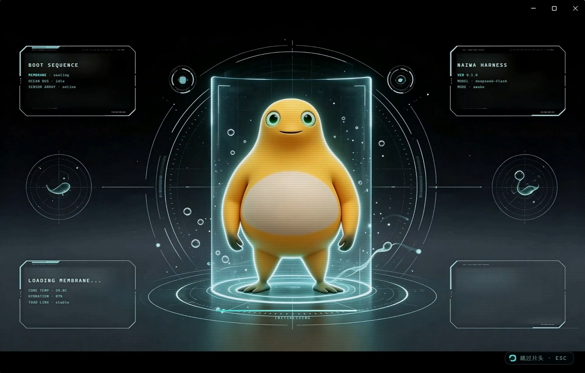
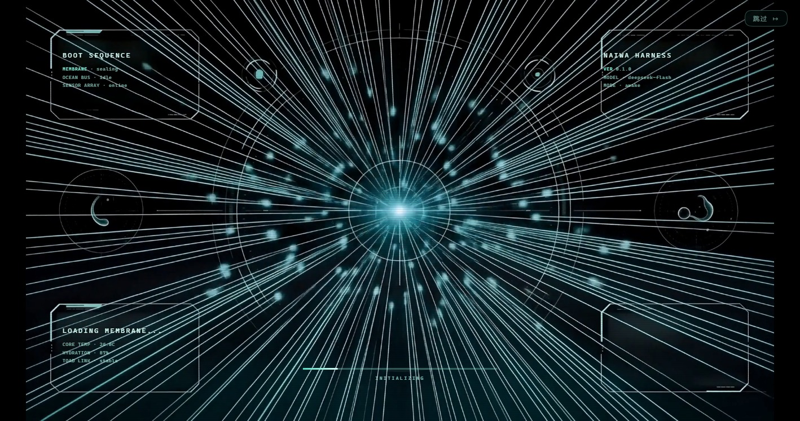
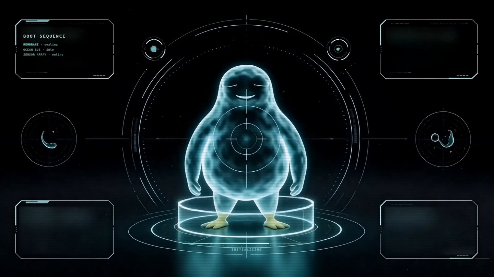
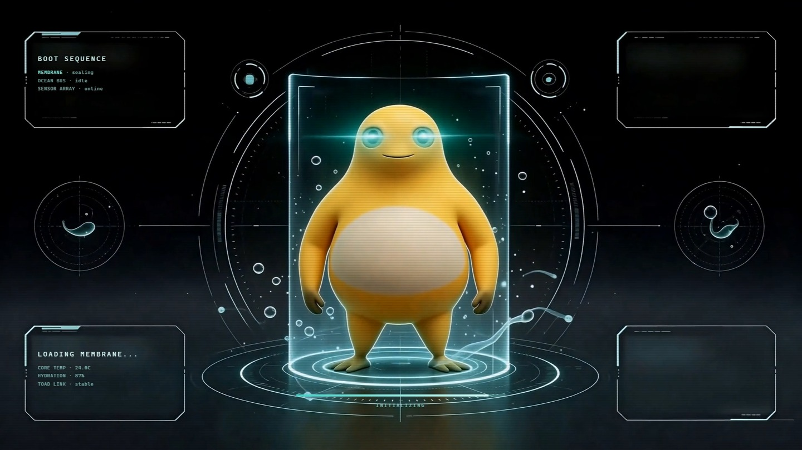
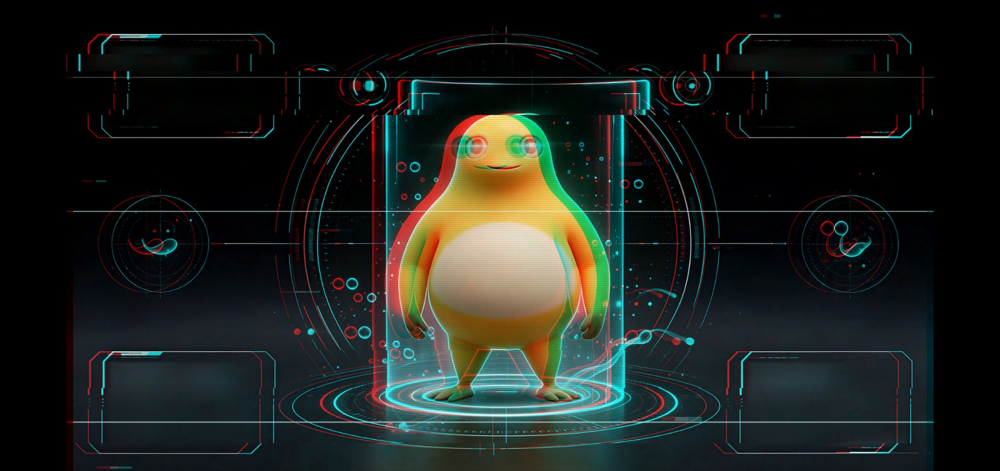
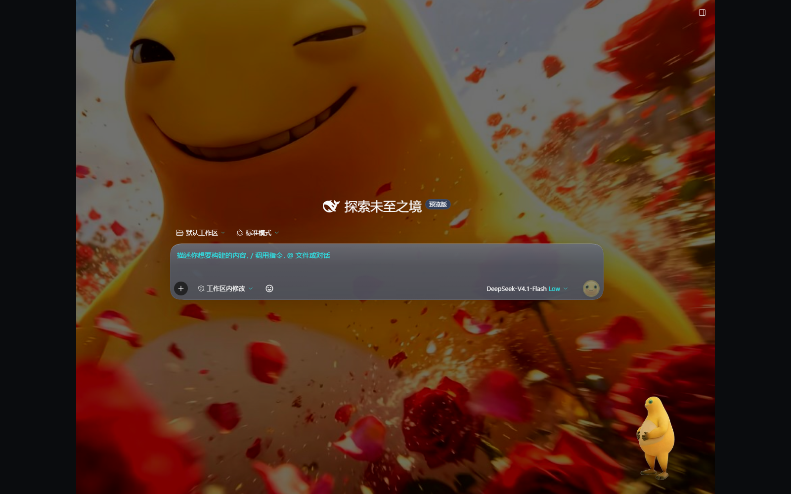
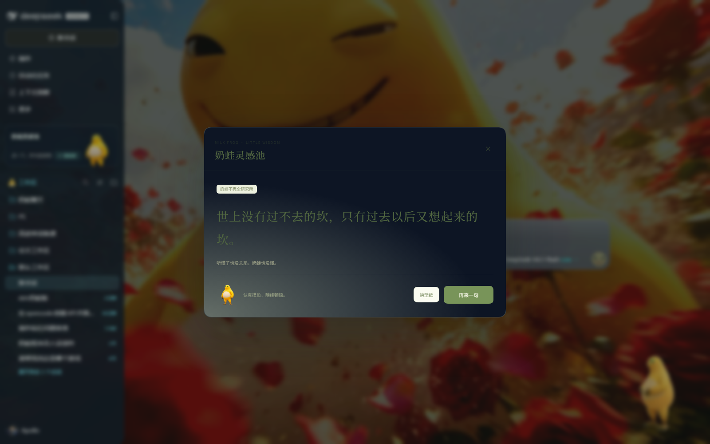
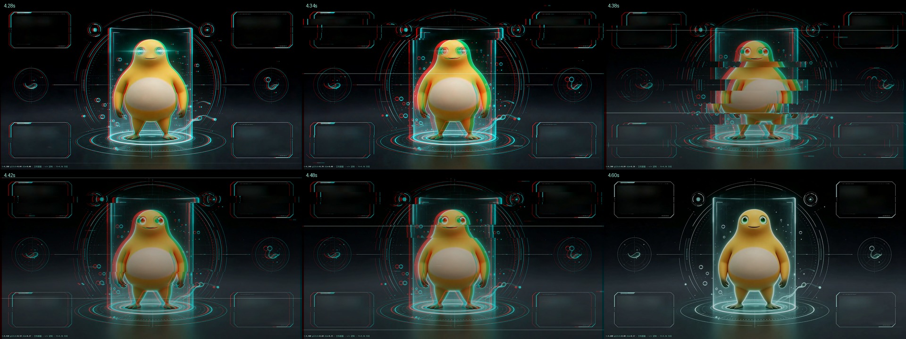

# dsh-naiwa-studio

奶蛙主题插件 for [DeepSeek Harness](https://github.com/deepseek-ai)：赛博朋克开机动画、灵感池卡片、
表情包快捷上传、壁纸引擎整合、玻璃质感 UI。

[](LICENSE)
[](LICENSE-ASSETS)



| 启动动画关键帧 | |
| --- | --- |
| **数据流汇聚（1.2s）**<br> | **全息成形（3.3s）**<br> |
| **睁眼（4.2s）**<br> | **故障转场（4.38s）**<br> |

## 效果

| 主界面 | 灵感池 |
| --- | --- |
|  |  |

<details>
<summary>启动动画逐帧（4.26s → 4.60s，睁眼瞬间的故障转场）</summary>



</details>


## 功能

- **启动动画**：`tapIndex` 注入独立 splash 运行时，5.6s 分镜 + 4 句机械语音 + 故障转场 + 真实加载进度。
  视频只负责 0–5.6s 的氛围，加载条与「SYSTEM READY」是 DOM 层，跟真实启动状态绑定——不会出现进度条走完了界面还没出来的尴尬。
- **灵感池**：侧栏卡片，点击弹出奶蛙语录；配色跟随壁纸引擎的玻璃设置实时变化。
- **表情包**：快捷面板左上角一张 `+` 卡，选图直接进当前情绪桶。
- **壁纸**：整合 [dsh-wallpaper-engine](https://github.com/elysia395/dsh-wallpaper-engine)，
  入口收在灵感池卡片的「壁纸库」胶囊上，强调色改成片头激光青 `#7ff0d8`。
- **桌宠**：与 [dsh-naiwa](https://github.com/weikangzeng07-ops/dsh-naiwa) 协作，
  提供命中区穿透与边界补丁。

## 安装

```bash
# 1) 先装依赖插件（可选，但推荐——壁纸与桌宠靠它们）
dsh plugin --profile desktop add dsh-plugin-wallpaper-engine
dsh plugin --profile desktop add "github:weikangzeng07-ops/dsh-naiwa"

# 2) 装本插件
dsh plugin --profile desktop add "github:alaricchanchs-crypto/dsh-naiwa-studio"

# 3) 完全退出并重启 Desktop（关窗口不算退出）
```

一键脚本（会顺带做依赖检查）：`powershell -ExecutionPolicy Bypass -File .\scripts\install.ps1`

### 没装 git 怎么办

`github:` 这种方式靠 git 拉代码，没装 git 会报 `git not found`。两条替代路线，任选一条：

**A. 用脚本一键装（推荐，不需要 git）**

```powershell
powershell -ExecutionPolicy Bypass -File .\scripts\install-no-git.ps1
```

它会把源码包下载并解压到 `%LOCALAPPDATA%\dsh-naiwa-studio`，再用 `link:` 方式装进 profile。

**B. 手动：下载 ZIP → 解压 → link 安装**

1. 打开 <https://github.com/alaricchanchs-crypto/dsh-naiwa-studio> → `Code` → `Download ZIP`
2. 解压到任意目录，例如 `D:\dsh-naiwa-studio`
3. 执行（路径换成你的）：

```powershell
dsh plugin --profile desktop add "link:D:/dsh-naiwa-studio"
```

> `link:` 装的是本地目录，以后改代码不用重装；卸载用
> `dsh plugin --profile desktop remove dsh-naiwa-studio`。

## 桌宠补丁

本仓库**不包含** `dsh-naiwa` 的引擎文件，只提供补丁：

```bash
cd ~/.dsh/plugins/dsh-naiwa
git apply /path/to/naiwa-bounds.patch
```

补丁做三件事：让可见蛙身能贴到窗口边（原实现按整块画布夹取，可见身体永远差一截）、
窗口/全屏切换时按比例搬移位置、初始位置按可视视口计算。

## 素材与授权

本仓库**不含壁纸**——壁纸请用 dsh-wallpaper-engine 的上传入口自行添加。

启动动画视频由 Minimax H3 生成，奶蛙形象为社区二创，授权说明见
[LICENSE-ASSETS](LICENSE-ASSETS)；第三方代码与素材的版权声明见
[THIRD-PARTY-NOTICES](THIRD-PARTY-NOTICES.md) 与 [CREDITS](CREDITS.md)。
若相关权利人提出异议，会立即移除对应素材。

## 许可

- 代码：MIT
- 图像与音频：CC BY-NC 4.0（禁商用）

## 文档

- [INSTALL.md](INSTALL.md)：完整安装、可选依赖、验收清单、回滚
- [AGENTS.md](AGENTS.md)：给 AI 的复现协议（把仓库地址 + 这个文件丢给 AI 就行）
- [CREDITS.md](CREDITS.md)：上游项目与致谢
